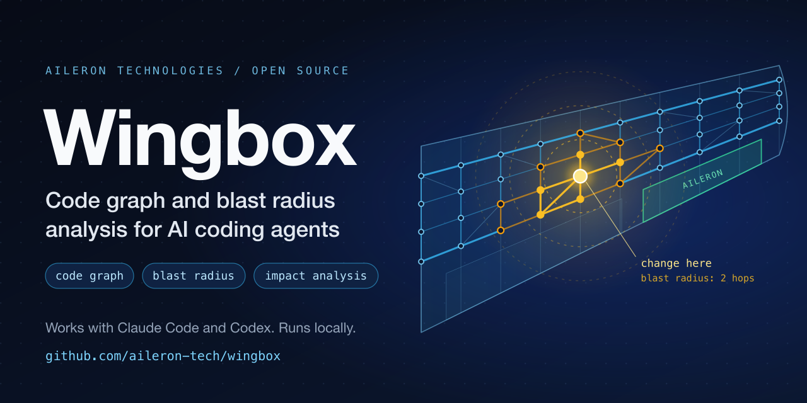

# Wingbox: a map of your codebase for AI coding agents

<!-- mcp-name: io.github.aileron-tech/wingbox -->



> **Give your coding agent a map of your codebase. Half the cost, no missed files.**
>
> Your agent sees every file a change touches before it edits, so it no longer
> forgets a fix. Half the cost of its own search: [benchmarks](https://github.com/aileron-tech/wingbox/blob/main/benchmarks/impact/README.md).
>
> Wingbox builds a local **code graph** (a code knowledge graph made by static
> parsing, with no model) of your repository so that AI coding
> agents and developers can see dependencies, call flows, architecture
> boundaries and the **blast radius** of a change before editing code.
> It works as an agent skill in Claude Code, Codex, Gemini CLI, Cursor and
> GitHub Copilot, as an MCP server for any MCP client, and from the command
> line. It supports Python, TypeScript, Rust, C#, Java, Go, Ruby, Rails, PHP,
> Laravel (Blade, Livewire), Dart, Flutter, Free Pascal, and Lazarus.
>
> **Runs fully locally:** no network access, no model, no telemetry. It can be
> used inside a security perimeter and on a machine with no internet.
>
> **macOS, Linux and Windows:** on Windows it runs natively, from PowerShell,
> cmd or Git Bash, with no WSL.
>
> **Website:** [wingbox.dev](https://wingbox.dev): benchmarks with charts, a
> sample report and the live map.
>
> **Install:** `pipx install wingbox && wingbox install` | [PyPI](https://pypi.org/project/wingbox/):
> the command, then the skill, an always-on block and a search hook for every
> coding assistant on the machine. Then type `/wingbox` in your agent.
>
> **The graph keeps itself fresh:** in Claude Code a hook marks every edited
> file, and the next search patches only those files into the graph (about a
> second on a 1,200-file project); changes made by git or an editor are found
> too. See [Keeping the graph fresh](#keeping-the-graph-fresh).
>
> **Skill only:** `npx skills add aileron-tech/wingbox` | [skills.sh](https://skills.sh)
>
> **Release notes:** [Changelog](https://github.com/aileron-tech/wingbox/blob/main/CHANGELOG.md) · **What is next:** [Roadmap](https://github.com/aileron-tech/wingbox/blob/main/ROADMAP.md)
>
> **Note:** Wingbox was formerly published as `codespaces`. The skill, the
> scripts and the generated files were renamed on 2026-11-15; see the
> [Changelog](https://github.com/aileron-tech/wingbox/blob/main/CHANGELOG.md) for the old and new names.

Understand a large codebase before you change it. Wingbox is an
architecture-aware code search and impact analysis tool for Python, TypeScript,
TSX, Rust, C#, Java, Go, Ruby, Ruby on Rails, PHP, Laravel, Blade, Livewire,
Dart, Flutter, Free Pascal, and Lazarus repositories. It helps developers and
AI coding agents find the right module, trace dependencies, measure change
impact, and read only the source files that matter.

Use it for codebase architecture discovery, dependency graph search, blast-radius
analysis, call-flow tracing, monorepo navigation, and safer AI-assisted coding.

Everything runs on your machine. The code graph is built by deterministic
static parsing: no LLM call, no vector database, and no network access to build
or query it. Wingbox does not embed your code; to read folder names it uses a
built-in table of word vectors for architecture terms.

## INSTALL AND RUN

```sh
pipx install wingbox && wingbox install
```

```sh
wingbox build .
```

The first line installs the command and sets up your coding assistants: it lists
what it adds, lets you untick items, and writes only your own settings in your home
folder. The second maps the repository you are in into its `.wingbox/` folder. Then
ask your agent, or run `wingbox impact path/to/file`.

**No terminal? Install with a click**

- **Claude Desktop:** [download the extension](https://github.com/aileron-tech/wingbox/releases/latest/download/wingbox.mcpb),
  open the file, press Install, choose your project folder and switch it on.
  Wingbox builds the map the first time you ask.
- **Codex app:** Settings > Plugins > Add > Add a marketplace, paste
  `aileron-tech/wingbox` as the source, then press + next to Wingbox under
  Personal.

Both start Wingbox with [uv](https://docs.astral.sh/uv/), which has to be on the
machine.

## Runs fully locally, inside your security perimeter

Wingbox is safe to run on code that must not leave the company:

- **No network.** Building and querying the graph open no network connection.
  Run it with the network switched off to see for yourself:
  `docker run --rm --network none -v "$PWD":/repo wingbox`
  (PowerShell: `docker run --rm --network none -v "${PWD}:/repo" wingbox`).
  The one command that reaches the network is `wingbox update`, which runs
  your package installer (pipx, uv or pip) when you ask it to.
- **No model, no account, no key, no telemetry.** Nothing is sent to a model
  or to a service, and nothing is collected about its use.
- **Your code is read, never run.** Wingbox parses source files with its own
  parsers and calls `git` for the ignore rules; it does not execute the code,
  the tests or the build of the repository. The `--lsp` option, off by
  default, starts a language server that is installed on the machine.
- **The results stay in one folder of the repository, `.wingbox/`:** the
  graph `index.sexp`, `REPORT.md` and `map.html`. The map is one HTML file
  that loads nothing from outside and opens offline.
- **Works on a machine with no internet.** Fetch the package and its pinned
  dependencies once (`pip download wingbox -d wheels`), carry the folder
  inside, and install with `pip install --no-index --find-links wheels wingbox`.
- **Deterministic and open.** The same code gives the same graph; the source
  is MIT licensed and small enough to review.

**Where Wingbox writes.** Nothing else on the machine is changed:

| Command | Writes to |
|---|---|
| `wingbox build` (and the refresh after a change) | the repository's `.wingbox/` |
| `wingbox init` (project setup) | the repository's `.wingbox/` |
| `wingbox install` (your assistants) | your own settings in your home folder (the assistants' files, `~/.wingbox/`) |

Three tests of the repository keep this true: the package imports no module
that opens network connections, the map page loads no outside resource, and
every command run in a temporary repository with a temporary home folder
changes no path outside `.wingbox/` and that home folder.

## See it in action

<p align="center">
  
</p>

Once the graph is built, an agent asks what a change breaks before it edits
anything. Real output, Wingbox 0.7.1 on the server of
[immich](https://github.com/immich-app/immich) (commit `e5d6eb7`, 707 modules):

```text
$ wingbox impact src/dtos/asset.dto.ts 2
Impact of changing src/dtos/asset.dto.ts
  direct dependents   10
  within 2 hops       30

Depth 1
  src/controllers/asset-media.controller.ts   imports
  src/controllers/asset.controller.ts         imports
  src/controllers/shared-link.controller.ts   imports
  src/controllers/user-admin.controller.ts    imports
  src/dtos/asset-media.dto.ts                 imports
  src/services/asset-media.service.ts         imports
  src/services/asset.service.ts               imports
  src/services/asset.service.spec.ts          imports
  src/services/shared-link.service.ts         imports
  src/services/user-admin.service.ts          imports

Depth 2
  src/controllers/index.ts                                 imports
  src/controllers/asset-media.controller.spec.ts           imports
  src/controllers/asset.controller.spec.ts                 imports
  ...
```

The answer is 30 files in about 600 tokens, and it is exact: a TypeScript
import resolver written separately from Wingbox finds the same 3,795
dependencies between the 707 modules, none extra and none missing.

`wingbox build` also writes `.wingbox/map.html` (`wingbox open` shows it). Its layers view stacks the
architecture in 3D; click a file and its blast radius lights up across the
layers:

| One DTO changes: 30 files within two hops | The base service changes: 281 of 707 modules |
|---|---|
|  |  |

Benchmarks with charts, a sample report and the live map: [wingbox.dev](https://wingbox.dev).

## What can Wingbox answer?

- Where is authentication, billing, upload, or another feature implemented?
- Which modules depend on this service, class, function, or type?
- Where exactly is this function, class or constant used, line by line?
- What could break if I change this file?
- Which two or three files should I read before fixing a bug?
- How does a request or data value move through the system?
- Does this dependency cross an architecture boundary?
- Which Rails models, services, jobs, mailers, concerns, and specs are affected?
- Can you draw a call-flow, data-flow, or sequence diagram from the code?

Instead of searching a repository one text match at a time, Wingbox turns code
into a queryable code graph of modules, entities, imports, references, call
relationships, architecture layers, and infrastructure connections.

## What is a code graph?

A code graph describes a codebase as facts instead of text. Modules, classes,
functions and types are nodes; imports, references, data flows, calls and
architecture layers are edges. Wingbox writes the graph to `.wingbox/index.sexp`
as plain S-expression facts, so the bundled query tool and ordinary text search
can both read it.

## What is blast radius analysis?

The blast radius of a change is everything that depends, directly or
transitively, on the code you are about to edit. Wingbox computes it from the
reverse dependencies in the code graph. `impact path/to/file` prints the
dependents by depth and the files to read first; `rdeps` and `boundary` give
the same facts as a tree and as a change boundary.

```text
$ wingbox impact scripts/lang/treesitter.py

Impact of changing scripts/lang/treesitter.py
  direct dependents   4
  within 2 hops       11

Depth 1
  scripts/lang/csharp/parser.py   imports
  scripts/lang/go/parser.py       imports
  scripts/lang/java/parser.py     imports
  scripts/lang/ruby/parser.py     imports
...
```

The text form is for people. Agents add `--sexp` to get the same facts as
compact S-expressions.

## Measured: 100 questions, with and without Wingbox

One hundred "which files depend on this file" questions, drawn at random with
a fixed seed in five public repositories (TypeScript, Rust, Python):

- `wingbox impact <file> 2 --all` names the complete list of dependent files,
  with nothing outside it, in 100 of 100 questions (95 % interval 96 to 100 %). The lists
  hold 1 to 503 files.
- Claude Code answers 55 of the questions with its built-in search only, and
  again with the `wingbox` command added:

| Setup | Complete answers | Tokens per answer | Cost per answer |
|---|---|---|---|
| With Wingbox | 55 of 55 | 32,183 | 0.031 USD |
| Built-in search only | 48 of 55 | 49,292 | 0.063 USD |

  Tokens -35 % (95 % interval -47 % to -20 %), cost -51 % (-58 % to -43 %).
  The saving is large on the Rust and Python repositories and absent on the
  two TypeScript ones.
- Checked against every import statement of seven corpora (3,795 dependencies
  in the largest), the graph has no wrong dependency and one missing: an
  import of a vendored bundle, which Wingbox leaves out of the graph.

The reference lists come from resolvers that share no code with Wingbox. The
scripts, the lists and every result file are in
[benchmarks/impact](https://github.com/aileron-tech/wingbox/blob/main/benchmarks/impact/README.md), with what the benchmark does
not show. `Dockerfile.benchmark` runs the tests that need no model in a clean
container and compares every result with the committed one:

```bash
docker build -f Dockerfile.benchmark -t wingbox-benchmark .
docker run --rm wingbox-benchmark
```

## Wingbox, Graphify, CodeGraph and OntoIndex on the same tests

[Graphify](https://github.com/Graphify-Labs/graphify) builds a knowledge graph
of a codebase, documents and images for coding agents; CodeGraph and OntoIndex
index code for agents. Wingbox is narrower: a deterministic graph of the code
alone, built without a model, and exact lists of what depends on a file. The
four ran on the same public repositories, questions, reference lists and
scoring (Wingbox 0.5.1, Graphify 0.9.110, CodeGraph 1.6.2, OntoIndex 3.1.9;
no model inside any of the tools):

| Test | Wingbox | Graphify | CodeGraph | OntoIndex |
|---|---|---|---|---|
| Exact list of dependent files, five questions | 5 of 5 | 1 of 5 | 1 of 5 | 1 of 5 |
| File dependencies of FastAPI against its 1,801 import pairs, wrong / missing | 0 / 0 | 19 / 16 | 106 / 24 | 22 / 117 |
| Tokens a coding agent spends per answer (built-in search alone: 59,367) | 23,768 | 109,071 | 81,151 | 78,070 |
| Cost per answer in that test, USD (built-in search alone: 0.075) | 0.021 | 0.095 | 0.070 | 0.075 |
| Answer quality in that test, F1 (built-in search alone: 0.999) | 1.000 | 0.997 | 0.993 | 0.977 |

Building the graph of FastAPI on a hosted runner takes Wingbox 2.2 s and
Graphify 17.9 s (measured with Wingbox 0.2.0; not measured for the other two).

What the others do better: CodeGraph's answers are the shortest where it
answers (1,000 tokens against 1,065 for Wingbox on the same three questions),
and per its documentation it covers more languages (Swift, Kotlin, C, C++, Lua
and others); per its documentation Graphify also maps documents, PDFs, images
and videos. `graphify affected` follows calls and references as well as
imports, so it answers a wider question than "who imports this file"; the
report gives its figures restricted to imports too. The scripts, the reference
lists, every result file and the token formula Graphify publishes are in
[benchmarks/graphify](https://github.com/aileron-tech/wingbox/blob/main/benchmarks/graphify/README.md).

## Find usages: 100 questions, three tools

"I will change exported symbol S of file X. Where is S used?" One hundred
questions on five public repositories in TypeScript, Rust and Python. Every
answer is checked against the language tooling (the TypeScript language
service, pyright, rust-analyzer) and the use sites against a SCIP index
(Wingbox 0.5.1, CodeGraph 1.6.2, Graphify 0.9.110):

| Tool | Exact list of files | Use sites found |
|---|---|---|
| `wingbox usages` | 100 of 100 | 1,660 of 1,660 |
| `codegraph callers` | 79 of 100 | 680 of 1,660 |
| `graphify affected --depth 1` | 76 of 100 (91 answered) | 604 of 1,660 |

CodeGraph keeps one entry per calling function and kind of use, which is why
it lists fewer sites; Graphify has no command that lists the uses of a symbol,
and `affected` is the nearest one. The questions, the reference lists and the
scripts are in [benchmarks/usages](https://github.com/aileron-tech/wingbox/blob/main/benchmarks/usages/README.md).

## Wingbox on Theory of Code Space

[Theory of Code Space](https://arxiv.org/abs/2603.00601) (ToCS) generates Python
codebases with a known architecture and scores a map of their dependencies by
edge type, with its own metric. Its agents explore with a budget of 20 actions;
Wingbox reads every file, with no model, which is closest to the paper's
condition where a model is given every file at once. On the paper's three
medium codebases:

| Map | Dep F1 | IMPORTS | CALLS_API | REGISTRY_WIRES | DATA_FLOWS_TO |
|---|---|---|---|---|---|
| Wingbox, this version | 0.953 | 150 of 150 | 19 of 39 | 19 of 19 | 16 of 16 |
| Wingbox 0.2.4 | 0.802 | 150 of 150 | 0 of 39 | 0 of 19 | 0 of 16 |

No edge outside the ground truth on these three. The CALLS_API left are calls
between files that also import each other, where the ground truth counts a call
of an API but not of a helper; Wingbox leaves that judgement to a model. The
scripts, the maps sent to the metric, eight more generated codebases and the
plan for a model that starts from the Wingbox map are in
[benchmarks/tocs](https://github.com/aileron-tech/wingbox/blob/main/benchmarks/tocs/README.md).

## Quick start for AI coding agents

Install the command and let it set up every coding assistant on the machine
(see [Install into your coding assistants](#install-into-your-coding-assistants)):

```bash
pipx install wingbox
wingbox install
```

In the agent, `/wingbox` builds the graph and summarizes the report,
`/wingbox path/to/file` shows what a change to that file breaks. Or ask a
natural question:

```text
Use the Wingbox skill before reading source.
Find where file uploads are handled, analyze that module, show its dependencies
and blast radius, then list only the boundary files needed for the change.
```

To install the skill alone, without the command's block and hook:

```bash
npx skills add aileron-tech/wingbox
```

MCP clients use `wingbox mcp`: see [Use from an MCP client](#use-from-an-mcp-client).

## Install as a plugin

This repository is also a plugin marketplace for Claude Code and Codex. The
plugin, in [`plugins/wingbox`](https://github.com/aileron-tech/wingbox/tree/main/plugins/wingbox), bundles the `wingbox` skill
and the MCP server `wingbox mcp`, and in Claude Code the search hook that
`wingbox install` adds. Use either the plugin or `wingbox install`, not both
(`wingbox uninstall` removes what install added).

Claude Code:

```text
/plugin marketplace add aileron-tech/wingbox
/plugin install wingbox@aileron-tech
```

From a shell, in one line: `claude plugin install wingbox --marketplace aileron-tech/wingbox`
(or `claude plugin marketplace add aileron-tech/wingbox`, then
`claude plugin install wingbox@aileron-tech`). The skill is `/wingbox:wingbox`.
The Claude Code plugin needs [uv](https://docs.astral.sh/uv/): its MCP server and hooks run
`uvx --from git+https://github.com/aileron-tech/wingbox@<commit> wingbox`, pinned to the commit of
the latest release tag, which uv fetches on first use. Claude Code starts `uvx` directly, with no
shell, so the plugin works the same on macOS, Linux and Windows, with or without Git for Windows.
The hooks run `uvx --offline`: they never download, and while uv is missing or has not fetched
Wingbox yet they fail without blocking the search or the edit (`"onFailure": "continue"`).

Codex:

```bash
codex plugin marketplace add aileron-tech/wingbox
codex plugin add wingbox@aileron-tech
```

The Codex plugin runs `wingbox` from your `PATH`, so install the command first
with `pipx install wingbox`. Codex lists the skill as `wingbox:wingbox`.

The plugin folder holds a copy of `SKILL.md` and `references/`, and the
version of `pyproject.toml`; `python3 tools/sync_plugin.py` refreshes them and
the tests fail while they differ.

## Claude Desktop

Wingbox is also a Claude Desktop extension. Download `wingbox-<version>.mcpb`
from the assets of the [latest release](https://github.com/aileron-tech/wingbox/releases/latest)
and install it: double-click the file, drag it into the Claude Desktop window,
or choose **Settings > Extensions > Advanced settings > Install Extension...**
and select it. In the extension settings, choose the repository Wingbox maps.

The first use builds the code graph of that repository (the `.wingbox/`
folder in it). A tool call waits up to 45 seconds for that first build; on a
large repository it answers that the build is still running, and the next call
a minute later answers from the graph. Later answers bring the graph up to date
with the files you change.

The extension holds no Python packages: it is an MCP Bundle of the server type
`uv`, which pins this release of `wingbox` from PyPI. The
[MCPB specification](https://github.com/modelcontextprotocol/mcpb/blob/main/MANIFEST.md#uv-runtime-v04)
says the host installs Python and the dependencies with uv, so that nothing
needs to be installed first; Wingbox's parsers ship as binary wheels for
macOS, Windows and Linux, so no compiler is needed. If your Claude Desktop
reports that it cannot start the server, install
[uv](https://docs.astral.sh/uv/getting-started/installation/) and restart it.
The first start downloads the package from PyPI; after that the server opens
no network connection. `python3 tools/build_mcpb.py` builds the file from a
checkout.

## Quick start from the command line

Install the `wingbox` command (Python 3.11 or newer, macOS, Linux or Windows):

```bash
pipx install wingbox
```

Or run it without installing:

```bash
uvx wingbox --help
```

Build the code graph of a project, then ask what a change will break:

```bash
cd /path/to/project
wingbox init                 # optional: state the architecture of each part
wingbox build .
wingbox impact path/to/file.py
wingbox usages path/to/file.py::create_order
wingbox quick "file upload"
```

`wingbox usages` lists every place that uses one symbol, through re-exports and
aliases, grouped by file, with the line, the column and the kind of use:

```text
Usages of Invoice (class, app/models.py:1)
  7 uses in 2 files

app/__init__.py
  1:21   re-export
app/billing.py
  1:17   import
  2:24   import
  4:13   extends
  7:13   type
  7:25   type
  8:11   call
```

The symbol is `Name`, `<file>::Name` or `<file>::Class.method`; a name defined
in several files lists the candidates. Kinds: `import`, `re-export`, `call`,
`type`, `extends` (extends or implements), `reference`. For a method, calls
whose receiver type is not in sight are listed as `unresolved-call`, never
guessed. At most 200 uses unless `--all`; `--sexp` prints the same answer as
`usage` facts. The build records which files use each definition; the first
`usages` after a change also reads every use position (a parallel pass over the
files, about as long as a build) and keeps them for the next calls. Python,
TypeScript, JavaScript and Rust have use positions; in
other languages `usages` names the files that reference the symbol.
### Architecture commands, with examples from immich (server)

Version 0.6.0 judges the architecture of each part of a repository by a
style from a library of styles (or by the rules the project declares itself)
and keeps it through the coding agent. One example of each command, run on the
`server` folder of [immich](https://github.com/immich-app/immich):

```text
$ wingbox init                      # the style of each part, written to .wingbox/config.yaml
.  nestjs (NestJS)   1.00   container
  *.repository.ts 60  *.service.ts 57  *.dto.ts 53  *.controller.ts 48

$ wingbox align                     # gaps against the style
.  nestjs: 371 of 475 files placed, 1132 of 1132 dependencies follow the rules

$ wingbox place "a client for the payment API"
src/repositories/  infra layer of nestjs
  because: placement: database access, client of another system

$ wingbox learn --agent             # the task for the coding agent: folders the style cannot place
Part .: closest style nestjs 1.00 (runner-up layered 1.00). Layers:

$ wingbox advice                    # open recommendations; accept or reject them by id
f7c97b6d2342  missing-folder  src/<feature>

$ wingbox compare                   # the parts of a monorepo side by side
.    typescript  nestjs  api domain infra service shared

$ wingbox boundaries all            # layer rules, then what each layer may do
(capability-violation src/services/shared-link.service.ts :capability db-client :layer service :allowed (infra module) :line 2 :evidence "import { PostgresError } from 'postgres';" ...)
(pattern-violation src/services/api.service.ts :pattern service-builds-http-response :line 99 ...)
(capability-summary :violations 15 :known 0 :candidates 0 :patterns 2 :checked 707)
```

On immich the capability rules find 15 files that do what their layer may
not (database client types in DTOs and services, query-builder helpers in
`utils/`) and 2 services that write the HTTP response themselves.

### The architecture of each part: `wingbox init`

`wingbox init [PATH] [--force] [--sexp] [--details] [--synonyms]` splits the repository into parts and
judges the architecture style of each, then writes `.wingbox/config.yaml`:

```
$ wingbox init
platform/backend   declared by platform/backend/layers.mjs (22 layers, read)   container
  also declared: platform/backend/.dependency-cruiser.mjs (not read: it states no layer order)
  known exceptions: platform/backend/layers.known-upward-imports.json (112 entries)
platform/frontend  route-tree (Vercel)   1.00   container
  app/ 828  components/ 574  page.tsx 135  ui/ 70
  target: 5 of 5 folders present
  advice: 2 to move, 59 to fix
  - move platform/frontend/src/app/llm/model-pools/_parts/pool-providers.tsx from the feature layer to ui ...
crates/engine      Rust crate, no layer style   -   component

wrote .wingbox/config.yaml
next: wingbox learn settles the open points (run by a coding agent it is the agent's task, asking you when the code does not tell; in a terminal it asks you), then wingbox build
```

- **Parts.** A part starts at a folder that holds a manifest (`package.json`,
  `pyproject.toml`, `setup.py`, `Cargo.toml`, `go.mod`, `Gemfile`,
  `composer.json`, `*.sln`, `pom.xml`, `settings.gradle`, `mix.exs`) and ends
  where a nested part starts; the repository root is always a part. A
  `pom.xml` below another one is a module of the same application. A part
  with fewer than 12 source files (tests and generated folders left out) is
  listed but not judged. Each part gets its C4 level (system for a workspace,
  container for a unit that runs by itself, component otherwise).
- **Styles.** layered (Martin Fowler, "Patterns of Enterprise Application
  Architecture", 2002), onion / clean architecture (Jeffrey Palermo, 2008;
  Robert C. Martin, "Clean Architecture", 2017), hexagonal / ports and
  adapters (Alistair Cockburn, 2005), model-view-controller, NestJS,
  microkernel / plug-ins (Mark Richards, 2015), route-tree frontends (Next.js
  `app/` and `pages/`, Remix, SvelteKit), Feature-Sliced Design, and CQRS (Greg
  Young; Martin Fowler) as an overlay. Each style is a TOML file in
  `scripts/architecture/styles/` with its sources, the folder words it is
  recognised by, its layers and its rules.
- **Score.** Each style scores the weight of its folder groups found in the
  part (a required group missing gives 0, a pattern of another style counts
  against it). A style is a candidate at score 0.6 and when its folders hold a
  quarter of the part's files; the part is determined when one candidate
  leads the next by 0.15. Otherwise the part is "not determined": no layers
  and no boundary violations are stated for it.
- **Own rules first.** A part that states its architecture itself
  (dependency-cruiser layers, import-linter, tach, deptrac, packwerk, ESLint
  boundaries, ArchUnit, ...) is judged by those rules. A dependency-cruiser
  layer list in plain data is read (its order and path patterns); a file Wingbox
  cannot read is named and no violation is stated for that part.
- **Folder names.** A folder matches a style word as a whole name after
  lowercasing and dropping `-` and `_`; a spelling variant one edit away
  matches (`controlers`). With `--synonyms`, a name still unmatched is
  compared with the style words through a built-in table of word vectors for
  architecture terms (GloVe, public domain), above a threshold; it is off by
  default because it did not improve accuracy on
  [benchmarks/architecture](https://github.com/aileron-tech/wingbox/blob/main/benchmarks/architecture/README.md). Each label
  says which step matched.

- **Target layout.** For each part with a style, `init` lists the full layout
  of that style: one folder per layer and the building blocks of the domain
  tier (entities, value objects, aggregates, domain events, domain services,
  repository interfaces, specifications; Eric Evans, "Domain-Driven Design",
  2003; Vaughn Vernon, "Implementing Domain-Driven Design", 2013), each marked
  present (with the real folder) or proposed (where the style puts it). It is
  written to `.wingbox/config.yaml`; no folder is created.

- **Recommendations.** Each part ends with its advice: folders of the target
  layout to create when such code appears, files to move (their dependents
  import them against the rules; the advice names the layer and the counts)
  and violations with the fix the style prescribes ("introduce a port in the
  domain and implement it in infrastructure"). `wingbox build` writes the same
  advice into REPORT.md ("Recommendations") and the map; `analyze` and
  `impact` print the advice that concerns the module. A part whose style is
  not determined gets no advice; a part with declared rules is advised by them.

- **Decisions.** `wingbox build` logs the advice it gives and what became of
  it in `.wingbox/decisions.sexp` (append-only, meant to be committed):
  followed, done differently, ignored, or accepted and rejected with
  `wingbox advice accept|reject <id> [--reason TEXT]`. A file moved to another
  folder than the advised one teaches that folder's layer for the part, and
  later builds use it (`:learned-from <id>`); an item rejected or ignored for
  3 builds is no longer shown. `wingbox advice` lists the open items,
  `wingbox advice --learned` what was learned.

- **What a layer may do.** Besides who imports whom, each style says what
  kind of work belongs where: SQL and the database client in the repository
  (DAO) layer, outbound HTTP in infrastructure, no web framework in the
  domain, the environment read in configuration (hexagonal: all I/O in the
  driven adapters). The build finds these capabilities by syntax in Python,
  TypeScript, PHP, Ruby, Java, C# and Go (a SQL string passed to `execute`,
  `query` or `raw`, query builders, `session.query`, Prisma model calls,
  `DB::select`, driver and ORM imports, `requests`/`axios`/`HttpClient`,
  `os.environ`/`process.env`, ...), each with its line, and `wingbox
  boundaries` reports a file outside the allowed layers:
  `(capability-violation src/services/orders.py :capability sql :layer service
  :allowed (infra) :line 42 :evidence "cursor.execute(\"SELECT ...\")")`. A
  query only kept in a variable is a candidate. A few pattern checks ride on
  the same data: a controller that imports a repository and skips the service,
  a service that builds an HTTP response, a domain file that imports the ORM.
  `capabilities:` of a part in `.wingbox/config.yaml` restates a rule; REPORT.md
  ("What layers do") and `wingbox advice` (`fix-capability`, `fix-pattern`)
  name the fix; `align --learn` accepts the current ones in the baseline. SQL
  assembled at run time or behind a helper of another package is not seen.

- **Align.** `wingbox align [PART] [--to STYLE] [--learn]` measures the gaps
  of each part against its style: files placed, dependencies that follow the
  rules, layers present and missing, folders without a layer, broken rules
  with an example; `--to` maps the layers onto another style (a migration
  view). `--learn` matches the part against the style library and takes the
  closest style as the base (its folders keep that style's layers); a folder
  it does not place is derived from its file names (`*.controller.ts`), its
  name in another style, and last its imports, each with its evidence; it
  writes the learned folders into
  `.wingbox/config.yaml` with a comment and what still breaks a rule into
  `.wingbox/baseline.sexp`; later builds report only new violations. For a
  part with declared rules nothing is guessed: the baseline comes from them.

- **A new project.** In a folder without source files, `init` asks the
  language and offers the styles that fit it, best first: the style of the
  other parts in the same language of the repository (monorepo siblings),
  then your favourite in `$HOME/.wingbox/config.yaml` (`defaults:
  {typescript: onion-clean}`), then the library. Without a terminal it prints
  the choices and the flags it needs (`--language`, `--style`, `--yes`); it
  writes the chosen style with its full target layout, and creates the empty
  folders only with `--scaffold`. Style files in `$HOME/.wingbox/styles/`
  replace the built-in ones of the same name.

- **Learn with an agent.** `wingbox learn` decides who runs it: `--agent`
  or `--human` first, then the variables a coding agent sets for its
  commands (Claude Code `CLAUDECODE=1`, Gemini CLI `GEMINI_CLI=1`), then a
  command without a terminal counts as an agent. An agent gets a task: the
  closest style, its layers, and each folder the style cannot place with real
  files and imports; it reads the files and answers in a fixed S-expression
  format. When the code does not tell (a public API or an internal helper?),
  the task tells the agent to ask the operator in its chat and pass the answer
  on, never to guess. `wingbox learn --apply` validates the answer (the whole
  answer is rejected with every error when a line is wrong), writes into
  `.wingbox/config.yaml` with `learned by agent: <because>` (an entry you
  wrote is kept), records in `.wingbox/learned.sexp` and rebuilds. A person in
  a terminal (`learn`, or `align --learn`) gets a questionnaire: the style of
  each part among its candidates, with scores and one-line descriptions, then
  one question per open folder with its files and imports; the answers are
  recorded the same way, and at the end `learn` offers to open
  `.wingbox/config.yaml` in `$VISUAL` or `$EDITOR` (`--yes` takes the closest
  style and the guesses). Nobody needs to edit the file by hand; it starts
  with a header of instructions (what each key means, the rule that decides a
  file's layer, how to move a folder, what to run after a change), rewritten
  on every write, so that an agent asked to change it does so correctly. Commit `.wingbox/`: its `.gitignore` keeps out
  the generated files (index, cache, report, map), so the folder shares
  `config.yaml`, `learned.sexp`, `decisions.sexp` and `baseline.sexp`.

If `.wingbox/config.yaml` exists, `init` keeps it and only prints the
candidates; `--force` rewrites it. `wingbox build` reads the file when it
exists and detects the styles itself when it does not. Every layer label and
every boundary violation names its style and rule: in the graph
(`(layer <module> api :style layered :rule "folder routes/ -> api")`), in
`wingbox boundaries`, in REPORT.md and in the map.

`wingbox build [PATH]` accepts the builder options described below, and every
query command in [Common code searches](#common-code-searches) is available as
`wingbox <command>`. The command installs the parsers for all supported
languages and finds the project by its `.wingbox/index.sexp`, in the current
directory or a parent; without one it says so and names the paths it looked
at. `wingbox open` shows the map of the project in the browser.

### Install into your coding assistants

```bash
wingbox install                            # every assistant whose configuration folder exists
wingbox install --dry-run                  # print the list and every file it would write, change nothing
wingbox install --assistant codex          # only the named assistants (repeatable)
wingbox install --without git-hook         # leave items out: ITEM or ASSISTANT:ITEM, comma separated
wingbox install --yes                      # ask nothing, even in a terminal
wingbox uninstall                          # remove exactly what install added
wingbox uninstall --without skill          # ... except the named items
```

`wingbox install` writes only your own settings in your home folder
(`%USERPROFILE%` on Windows). It shows what it is about to put in place, one
line with a checkbox per item, grouped by assistant:

| Item (`--without`) | What it is |
|---|---|
| `skill` | the `wingbox` skill, so `/wingbox` exists |
| `block` | a short always-on block in the instructions file the assistant reads in every session |
| `search-hook` | Claude Code: before each Grep, Glob and Read, context from the graph |
| `edit-hook` | Claude Code: after each Edit and Write, marks the edited file |
| `session-hook` | Claude Code: at session start, refreshes a graph older than the code, in the background |
| `git-hook` | Claude Code: after the agent ran `git switch`, `checkout`, `pull`, `merge`, `rebase`, `reset` or `stash pop`, refreshes the graph in the background |

In a terminal you untick items with the arrow keys and space (or, where the
terminal gives no single keys, by typing their numbers) and press Enter;
Enter alone installs everything, `q` installs nothing. Started by an agent,
from a script, in CI or with `--yes`, it asks nothing and installs every item
except those named by `--without` (`--without git-hook,codex:block`;
`--without none` puts everything back). The choice is recorded in
`~/.wingbox/installed.sexp`: a later `wingbox install` and `wingbox update`
refresh only the items you kept and never add back one you left out.
Running it again changes nothing; after an upgrade it refreshes the skill.
Assistants are found by their folders in the home directory: `~/.claude`,
`~/.codex`, `~/.gemini`, `~/.cursor`, `~/.copilot` and `~/.agents`.

| Assistant (`--assistant`) | Skill | Always-on block |
|---|---|---|
| Claude Code (`claude-code`) | `~/.claude/skills/wingbox` | `~/.claude/CLAUDE.md` |
| Codex (`codex`) | `~/.agents/skills/wingbox` | `~/.codex/AGENTS.md` |
| Gemini CLI (`gemini`) | `~/.gemini/skills/wingbox` | `~/.gemini/GEMINI.md` |
| Cursor (`cursor`) | `~/.cursor/skills/wingbox` | none (user rules live in the settings) |
| GitHub Copilot, CLI and VS Code (`copilot`) | `~/.copilot/skills/wingbox` | `~/.copilot/copilot-instructions.md` |
| Shared Agent Skills folder of `npx skills` (`agents`) | `~/.agents/skills/wingbox` | none |

**For a whole team.** Wingbox writes nothing into a repository outside
`.wingbox/`. `wingbox init` prints, and saves in `.wingbox/assistant-setup.md`
(meant to be committed), the lines a team may add by hand to the repository's
own files so that every member's assistant uses Wingbox there: the always-on
block for `AGENTS.md` and `CLAUDE.md`, and the four hook entries for a
committed `.claude/settings.json` (they run `wingbox` from `PATH`).

**Moving from `wingbox install --project`.** It was removed in 0.9.0. In each
repository where you used it, run `wingbox uninstall --project` (it removes only
the marked blocks, the hook entries and the skill folders that install wrote),
then `wingbox install` once for your own assistants; `wingbox update` names
these repositories until then.

- **The block** sits between `<!-- wingbox:begin -->` and
  `<!-- wingbox:end -->`. It tells the agent to run `wingbox quick` or
  `wingbox analyze` before reading code, `wingbox impact <file>` before
  changing a file, and `/wingbox` for an overview. Text outside the markers is
  never touched; a file that links to another one (`CLAUDE.md` to `AGENTS.md`)
  gets one block.
- **The Claude Code hooks** in `~/.claude/settings.json` are a `PreToolUse` entry with the
  matcher `Grep|Glob|Read` that runs `wingbox hook pre-search`, a `PostToolUse` entry with the
  matcher `Edit|Write|MultiEdit` that runs `wingbox hook dirty`, a `SessionStart` entry that
  runs `wingbox hook session-start`, and a `PostToolUse` entry with the matcher `Bash` that
  runs `wingbox hook git` (it reads the command and acts only on the git commands above; it
  prints nothing). All are written in
  exec form (`"command"` the program, `"args"` `["hook", "pre-search"]`) with
  `"onFailure": "continue"`: Claude Code starts the program with no shell, so the hooks work on
  Windows with or without Git Bash, and a missing program never blocks a tool call. Install
  names the full path of the `wingbox` program (`wingbox.exe` on Windows). When the project has a
  graph, the search hook adds a few lines of context to the search: the modules and
  definitions that match the pattern with their direct dependents, or for a
  file its dependents and the hint to run `wingbox impact`. It answers in
  0.4 to 0.7 s on a graph of 8,000 files, Python start included, never blocks the tool, opens no
  network connection. In a source repository without a graph it says so once per
  session, as `(wingbox-no-graph :root <root> :hint ...)` naming `wingbox build`
  (it never builds by itself; the "already told" mark is kept under
  `~/.wingbox/hook-hints`, not in the project); elsewhere it says nothing. A Grep
  pattern matches with smart case: without an upper-case letter it ignores case. The edit
  hook only marks the edited file (see "Keeping the graph fresh"). Other
  settings and hooks are kept; the file is backed up once to
  `settings.json.wingbox-bak` before the first change.
- **A skill folder that another installer wrote** (for example
  `npx skills add`) is left as it is. Install records what it did in
  `~/.wingbox/installed.sexp`; `wingbox update` and `wingbox uninstall` read
  it.
- **`/wingbox`** with no argument builds the graph when it is missing or
  older than the code and summarizes `.wingbox/REPORT.md`;
  `/wingbox <file>` runs `wingbox impact <file> 2`; `/wingbox <command> ...`
  runs that command. In Codex the skill is called as `$wingbox`.

Every result is a list of facts: `--sexp` prints them as S-expressions such as
`(install-wrote ~/.claude/skills/wingbox :what skill :assistant (claude-code) :version 0.2.6)`,
and the default output is the same facts as aligned text.

### Update

```bash
wingbox update --check    # installed and latest version, nothing installed
wingbox update --dry-run  # the command it would run
wingbox update            # upgrade, then refresh what wingbox install put in place
```

`wingbox update` upgrades with the installer that installed Wingbox: pipx
(`pipx upgrade wingbox`), uv (`uv tool upgrade wingbox`) or pip of the Python
environment it runs in. A Docker image or an editable or local install cannot
update itself; the command says so and prints what to run instead. Wingbox
itself opens no network connection: only the installer reaches the package
index, and only when you run `wingbox update`.

It also looks for files that versions before 0.4.1 wrote outside `.wingbox/`
(`.code_graph.sexp`, `.code_graph.uses.sexp`, `.code_graph.uses-cache.json`,
`.code_graph_cache.json`, `wingbox-out/`), in the current folder and its
parents up to the project root and in every repository an earlier
`install --project` recorded, and prints one warning line per project (yellow
on a terminal); it deletes nothing. `wingbox update` refreshes only your own
settings: for each repository where a version before 0.9.0 installed with
`--project` it says once that those files are still there and that
`wingbox uninstall --project` in that folder removes them.

### Keeping the graph fresh

The graph follows the code without `wingbox build`. Before the search hook,
an MCP tool or a query command reads it, the files changed since it was built
are brought in:

- In Claude Code, `wingbox hook dirty` (PostToolUse on Edit and Write) marks
  the edited file in `.wingbox/graph-state.json` and returns; it never builds.
- At the start of a session (`wingbox hook session-start`) and after the agent
  ran `git switch`, `checkout`, `pull`, `merge`, `rebase`, `reset` or
  `stash pop` (`wingbox hook git`, PostToolUse on Bash), the changed files are
  found at once and a refresh starts in the background; the hook prints nothing
  and returns, so the first search usually meets a graph that is fresh already.
- Changes made elsewhere (an editor, `git checkout`, a script, a shell
  command) are found by comparing the size and modification time of every
  source and resolution config, and the time of every folder, with the
  snapshot the last build wrote: one `stat` per entry, no hashing.
- The changed files are patched in: only they are parsed again, and only the
  modules that read them, that resolved a name a created or deleted file could
  now answer, or that looked up a name the change added or removed are
  resolved again. The result is the graph a build publishes, byte for byte.
  A changed `package.json`, `tsconfig*.json`, `pyproject.toml`, `.gitignore`
  or other resolution config, a changed source in a language other than
  Python and TypeScript, or a change that reaches more than a quarter of the
  modules takes the incremental build instead. Several edits are brought in
  by one refresh, and never two run at once for one project.
- The search hook waits up to `WINGBOX_HOOK_WAIT` seconds (3) for the refresh;
  a longer one goes on in the background and publishes when it is done. While
  the graph misses known changes, after a failed refresh (not repeated until
  something changes again) or with `WINGBOX_AUTO_REFRESH=0`, the hook gives no
  context from it but `(wingbox-graph-stale :reason ...)`; MCP answers start
  with that line and query commands print it on stderr.
  `WINGBOX_REFRESH_WAIT` (600 s) is the wait of MCP tools and query commands;
  `WINGBOX_CHECK_INTERVAL` (0) spaces out the file-system checks.

Measured on a shared machine under heavy load (load average 20 to 55), wall
time, the version before this change and after it, runs interleaved:

| | fastapi, 1,227 Python files | TypeScript monorepo, 6,834 files |
|---|---|---|
| Search hook, nothing changed | 0.20 -> 0.24 s | 0.30 -> 0.38 to 0.52 s |
| of which the check for outside changes | 0.02 s (1,666 entries) | 0.17 s (9,748 entries) |
| Edit hook | 0.21 s | 0.26 s |
| One edited file patched in | 1.0 s (24 modules redone) | 9 to 13 s (12 modules redone) |
| Incremental build after one edit | 11.2 -> 4.4 s | 23.0 -> 25.9 s |
| Build without changes | 11.1 -> 3.3 s | 20 to 23 -> 20 s |
| Cold build | 24.1 -> 7.0 s | 44 -> 47 s |

A patch grows with the modules it redoes: on fastapi 0.6 s for 1 file, 1.1 s
for 10, 1.4 s for 50 and 3.3 s for 150 files (234 modules), against 3.5 to
5.6 s for the incremental build of the same changes. On the monorepo the
patch is dominated by reading and writing the build cache (35 MB) and the
fragment store (39 MB); it takes longer than the search hook waits, so the
first search after an edit there answers `(wingbox-graph-stale :reason
refresh-timeout ...)` and the next ones, once the patch is published, use the
new graph.

### The report and the map

`wingbox build PATH` creates `PATH/.wingbox/` and writes everything there;
nothing else in the project is written. The folder also marks the project:
every command, the hooks and the MCP server look for the nearest
`.wingbox/index.sexp` at or above the current folder, and that folder is the
project root.

| File in `.wingbox/` | For whom | What it is |
|---|---|---|
| `index.sexp` | AI coding agents | The code graph in a compact form that the query commands read |
| `index.uses.sexp` | AI coding agents | Module-level variables and the files that use each definition; `usages` adds every use position on its first call |
| `index.uses-cache.json` | Wingbox | The use walk of each file by content hash, so that `usages` after a change reads only the changed files |
| `cache.json` | Wingbox | The parse of each file by content hash, so that a build reads only changed files |
| `REPORT.md` | People | Key findings, the most depended-on files, architecture layers, boundary violations, where to start reading |
| `map.html` | People | An interactive map of the code graph: one file, opens in a browser (`wingbox open`), works without a network connection |
| `graph-*`, `refresh.*` | Wingbox | What keeps the graph fresh: the facts of each module and what they were read from, the sizes and times of the sources at the build, the folder it was built from, the files changed since (see "Keeping the graph fresh") |
| `.gitignore` | git | Ignores every file above and itself, so that a plain `wingbox build` leaves `git status` clean and a file you write into `.wingbox/` later stays in the repository |
| `config.yaml`, `learned.sexp`, `baseline.sexp` | People and agents | The architecture of each part, what `wingbox learn` learned, the known rule breaks (`wingbox init`, `learn`, `align --learn`); not ignored, commit them |
| `decisions.sexp` | People and Wingbox | The advice each build gave and what became of it; started once the project is set up (`wingbox init`, `learn`, `align --learn` or `advice`), not ignored, commit it |

On the map, click a file to see its blast radius: the files that depend on it
move onto rings, one ring per hop. The layers view stacks the architecture
layers as planes in 3D and can be turned with the mouse. A link such as
`map.html#select=src/app.ts` opens the map on that file.

The generated files are rewritten on every build and never committed thanks to
`.wingbox/.gitignore`; you can also ignore the whole folder. In a repository nobody has set up with
`wingbox init`, a build leaves nothing for git to show; `config.yaml`, `learned.sexp`, `baseline.sexp` and
`decisions.sexp` appear once they are written, on purpose, since they record what people and agents
decided. A `.wingbox/`
folder copied or moved to another place is read as it is but never refreshed
there: queries say `rebuild`. Wingbox deletes nothing outside `.wingbox/`;
`wingbox update` names files that versions before 0.4.1 left in a project
(`.code_graph*`, `wingbox-out/`) so that you can remove them.

### Run in Docker, with nothing installed

```bash
git clone https://github.com/aileron-tech/wingbox
docker build -t wingbox wingbox

cd /path/to/project
docker run --rm --network none -v "$PWD":/repo wingbox
docker run --rm --network none -v "$PWD":/repo wingbox impact path/to/file.py
```

In PowerShell on Windows:

```powershell
cd C:\path\to\project
docker run --rm --network none -v "${PWD}:/repo" wingbox
docker run --rm --network none -v "${PWD}:/repo" wingbox impact path/to/file.py
```

The first `docker run` builds the code graph, the report and the map of the
mounted project; any other Wingbox command goes after the image name. The
container needs no network, and `--network none` shows it: nothing leaves the
machine. On Linux add `--user "$(id -u):$(id -g)"` so that the written files
belong to you.

### Running the scripts from a clone

Clone the repository:

```bash
git clone https://github.com/aileron-tech/wingbox.git
cd wingbox
```

Build the code graph for an explicit project directory:

```bash
python3 scripts/build_code_graph.py --root /absolute/path/to/project
```

On Windows the interpreter is `python` (or `py`), and paths may use either slash:

```powershell
python scripts\build_code_graph.py --root C:\absolute\path\to\project
```

Exclude tracked source snapshots or generated fixture trees by directory name.
The option is repeatable and applies at any depth:

```bash
python3 scripts/build_code_graph.py \
  --root /absolute/path/to/project \
  --exclude-dir review-bundles \
  --exclude-dir generated-fixtures
```

When the target is inside a Git worktree, the builder also honors repository
ignore rules through Git itself. This applies to source files and language
configuration such as `tsconfig.json`, `package.json`, `Cargo.toml`, `go.mod`,
and LSP project discovery. Tracked snapshot paths that still match
`.gitignore` are excluded as well.

Parser packages are loaded only for languages found in that project. Python
needs no extra parser package. If another detected language is not installed,
the builder stops before publishing and prints its exact install command, for
example:

```bash
python3 -m pip install -r requirements/typescript.txt
python3 -m pip install -r requirements/csharp.txt
python3 -m pip install -r requirements/ruby.txt
python3 -m pip install -r requirements/php.txt
python3 -m pip install -r requirements/dart.txt
```

Install only the files for languages you use, then run the same build command
again. `requirements/php.txt` pins `tree-sitter==0.25.2` and
`tree-sitter-php==0.24.1` and `requirements/dart.txt` pins
`tree-sitter-dart==0.1.0`. The package dependencies list the PHP grammar, so an
installed `wingbox` needs no separate step for PHP. The Dart grammar is an
opt-in extra: `pipx install "wingbox[dart]"` (or `pip install "wingbox[dart]"`);
without it a build skips `.dart` files with a warning and maps the rest.
`requirements.txt` contains the separate infrastructure-topology dependency.

Run a relevant search and get the first matching module with its full context:

```bash
python3 scripts/code_graph_search.py \
  --map /absolute/path/to/project/.wingbox/index.sexp \
  --root /absolute/path/to/project \
  quick "file upload"
```

The code graph is written to `.wingbox/index.sexp`. Wingbox does not modify the
source files it analyzes.

## Use from an MCP client

`wingbox mcp` runs Wingbox as an MCP (Model Context Protocol) server: the
client starts the command, sends JSON-RPC requests on its standard input and
reads the answers on its standard output. The transport is stdio only: no
port, no network. Logs go to standard error. Every tool carries MCP
annotations: a title, and read-only for every tool except `build`, which
writes the graph; no tool is destructive or reaches outside the repository.

```bash
wingbox mcp                         # serve the current directory
wingbox mcp --root /path/to/project
```

The server speaks protocol revision 2026-07-28 (requests with per-request
`_meta`, `server/discover`) and the `initialize` handshake of revisions
2025-11-25, 2025-06-18, 2025-03-26 and 2024-11-05.

| Tool | What it answers |
|---|---|
| `build` | Build or refresh the code graph (`full`, `exclude_dirs`) |
| `impact` | Blast radius of a file, as text (`target`, `depth`, `all`) |
| `analyze`, `quick` | Full analysis of a module, or of the first module matching a keyword |
| `boundary`, `boundaries`, `layers` | Files to read for a change; layer violations; modules by layer |
| `deps`, `rdeps` | Dependency and reverse dependency trees |
| `entity`, `find_function`, `find_type` | Where a name is defined and used |
| `usages` | Every use of one symbol by file, line:column and kind, as text (`symbol`, `all`) |
| `find_callers`, `find_calls`, `find_callchain` | Call graph questions |
| `diff_functions` | Functions changed since a git ref |
| `query` | A Scheme query on the graph |

Each tool returns the output of the `wingbox` command of the same name. A
query tool called before the graph exists answers that `build` must be called
first. Answers stop at 200 items; `all: true` lists everything. The graph is
read once and read again when `.wingbox/index.sexp` changes.

Claude Code, in the project directory:

```bash
claude mcp add wingbox -- wingbox mcp
```

`--scope project` writes the server into `.mcp.json` for everyone working on
the project; `--scope user` makes it available in all your projects.

Codex, in `~/.codex/config.toml` (or `codex mcp add wingbox -- wingbox mcp`):

```toml
[mcp_servers.wingbox]
command = "wingbox"
args = ["mcp"]
cwd = "/path/to/project"
```

Cursor, in `.cursor/mcp.json` of the project (or `~/.cursor/mcp.json`):

```json
{
  "mcpServers": {
    "wingbox": {
      "command": "wingbox",
      "args": ["mcp", "--root", "${workspaceFolder}"]
    }
  }
}
```

Claude Desktop, in
`~/Library/Application Support/Claude/claude_desktop_config.json` on macOS.
Claude Desktop starts servers in an undefined directory and with a reduced
`PATH`, so give absolute paths for the command and the project (`which wingbox`
prints the first):

```json
{
  "mcpServers": {
    "wingbox": {
      "command": "/absolute/path/to/wingbox",
      "args": ["mcp", "--root", "/absolute/path/to/project"]
    }
  }
}
```

Without installing, `uvx wingbox mcp` works in place of `wingbox mcp`
(`"command": "uvx", "args": ["wingbox", "mcp", ...]`).

## Common code searches

| Goal | Command |
|---|---|
| Find and analyze a feature | `quick "payments"` |
| Search for a module | `search "payment.*service"` |
| See full module context | `analyze path/to/module` |
| Find files needed for a change | `boundary path/to/module --files-only` |
| Trace dependencies | `deps path/to/module 2` |
| See what a change will break | `impact path/to/file.py` |
| Find every use of one symbol | `usages path/to/file.py::create_order` |
| Measure blast radius as a tree | `rdeps path/to/module 2` |
| Find a class, module, interface, enum, or type | `find_type OrderService` |
| Find a function or method | `find_function createOrder` |
| Find callers | `find_callers createOrder 2` |
| Trace a call path | `find_callchain handleRequest createOrder 5` |
| Search inside function bodies | `grep_functions "validate.*input"` |
| State the architecture of each part | `wingbox init` (`--sexp` for agents) |
| See or decide the open recommendations | `wingbox advice`, `wingbox advice reject <id> --reason "..."` |
| Measure architecture gaps, learn the current architecture | `wingbox align`, `wingbox align --to hexagonal`, `wingbox align --learn` |
| Ask where new code goes | `wingbox place "a client for the payment API"` |
| Let the coding agent decide the folders a style cannot place | `wingbox learn --agent`, then `wingbox learn --apply < answer.sexp` |
| Compare the architectures of the parts of a monorepo | `wingbox compare` |
| Check architecture boundaries and what each layer may do (SQL, HTTP, framework; each line names part, style and rule) | `boundaries all` |
| Show the layer of every module with its style and rule | `layers` |
| Check naming conventions | `invariants all` |
| Inspect changed functions | `diff_functions HEAD~1` |

`analyze` and `impact` always print the complete counts and list at most 200
dependent files, nearest first; add `--all` for every file. `boundaries` reports
an import of TypeScript types only apart from the violations: the compiler
erases it, but a change of the type still reaches the importing file.
`boundaries` prints `boundaries-ok` only when every part with files was
checked. A part whose own rule files were not read (or without a determined
style) comes first as `(boundaries-not-checked :part . :reason
declared-rules-not-read :files (.dependency-cruiser.js) :files-in-part 1177)`,
and `(boundaries-partial :checked N :not-checked M)` replaces `ok`. Exit
status: 2 when a part's declared rules were not read, 1 when a violation was
found, 0 otherwise; REPORT.md, `wingbox advice` and the MCP `boundaries` tool
say the same.

Pass `--map` and `--root` (see [Running the scripts from a clone](#running-the-scripts-from-a-clone))
when the graph is outside the current directory and its parents.

## Supported languages and projects

| Language | What is indexed |
|---|---|
| Python | Modules, imports, modules loaded through `importlib` (literal names, and names read from a JSON, YAML or TOML file beside the loader), classes, functions, methods, inheritance, and references |
| TypeScript, TSX and JavaScript | Imports, re-exports, classes, interfaces, functions, types, decorators, aliases, and references |
| Rust | Cargo crates, modules, `use` dependencies, structs, traits, enums, functions, implementations, and methods |
| C# | Namespaces, types, interfaces, records, enums, methods, attributes, inheritance, and local type dependencies |
| Java | Packages, imports, classes, interfaces, records, enums, methods, annotations, inheritance, and local type dependencies |
| Go | Modules, packages, imports, structs, interfaces, functions, constants, variables, receiver methods, and local package dependencies |
| Ruby and Rails | Ruby classes, modules, instance and singleton methods, inheritance, requires, Zeitwerk constants, concerns, associations, callbacks, jobs, mailers, and impacted specs |
| PHP and Laravel | PHP 8 classes, interfaces, traits, enums, methods, attributes, `use` aliases, inheritance, Composer PSR-4 classes, Blade views and components, Livewire components, Eloquent associations, events, and jobs |
| Dart and Flutter | Dart classes, mixins, enums, extension types, extensions, type aliases, functions, inheritance, `import`/`export`/`part`/`part of` directives, the project's own `package:` libraries and relative files |
| Free Pascal and Lazarus | Units, programs, uses/includes, classes, records, interfaces, inheritance, methods, and routines |

Wingbox is designed for single repositories and monorepos. It understands
Python project roots, TypeScript configuration and package aliases, Cargo package
names and local Rust crate dependencies, .NET solutions and projects, Maven and
Gradle projects, Go modules and workspaces, Rails application/autoload
roots with project acronyms, Composer PSR-4 roots, including nested module
manifests and `autoload-dev`, and Dart `pubspec.yaml` package names, including
the packages of a monorepo.

Pascal dependencies resolve by case-insensitive unit identity and explicit
`UnitName in 'path.pas'` paths, then by a unique same-directory unit. Other
ambiguous unit names remain unlinked, compiler conditionals are indexed
conservatively, and Pascal does not use LSP enrichment. Automatic Pascal copies
under Lazarus `backup/` directories are excluded without excluding other
supported languages stored under the same path.

It can also map infrastructure relationships from Kustomize, Helm, and Terraform.

## Ruby and Rails dependency search

Rails code often depends on constants without an explicit `require`. Wingbox
builds a project-local constant index and follows conservative Zeitwerk naming
rules, so changing a shared model, concern, service, job, or mailer can reveal
its likely callers and affected specs.

The default Ruby map does not boot Rails. Ambiguous reopened constants remain
unlinked, polymorphic associations stay open, and external or dynamic Ruby
calls are not guessed. This keeps blast-radius results useful without executing
application code.

## PHP and Laravel dependency search

PHP and Laravel code names classes through Composer instead of relative paths,
and one feature can span PHP classes, Blade templates and Livewire components.
Wingbox reads every `composer.json` (the root manifest and a module's nested
one) and merges `autoload.psr-4` with `autoload-dev.psr-4`, the longest matching
prefix first, as Composer does. A `.php` file is indexed as PHP, a `.blade.php`
file as Blade: classes, interfaces, traits, enums, methods, attributes, `use`
aliases and grouped uses, `extends`, `implements` and trait use.

Laravel conventions become edges. `view('users.show')`, `View::make(...)` and
`view()->make(...)` name the template; a namespaced `admin::nav` uses the
directories registered by `loadViewsFrom(...)` or `View::addNamespace(...)`, or
a module's `resources/views` directory. Blade `@extends`, the `@include*`
family, `@component` and `@each`, anonymous `<x-*>` components, and
`<livewire:counter>` or `@livewire('counter')` are followed. A Livewire
component resolves through `Livewire::component(...)` registrations, its flat
or dotted alias under `App\Livewire` or a module's `Livewire` folder, or its
`livewire.<alias>` template; a component class that extends
`Livewire\Component` also links to the template named after it
(`App\Livewire\Chat\FileUpload` to `livewire.chat.file-upload`).

Eloquent associations create edges when the first argument is `X::class`
(`belongsTo`, `hasOne`, `hasMany`, the through and morph variants);
`event(new X(...))`, `dispatch(new X(...))`, `X::dispatch(...)` and
`X::dispatchSync(...)` link events and queued jobs. Models are domain,
controllers, middleware and requests under `app/Http` are api, `app/Livewire`
and `resources/views` are ui, `app/Jobs`, `app/Listeners` and `app/Policies`
are service, `app/Events` is domain, and tests are test.

The map is conservative: a class name that no file declares, or that several
files declare without a single PSR-4 owner, creates no edge, and so do an alias
with several targets and a view in several view directories. IDE-helper stubs
such as `_ide_helper_models.php` do not shadow the real class: the file the
PSR-4 map autoloads wins. A Livewire alias that the application registers
dynamically, in a loop over a directory for example, is left unlinked unless it
also follows one of the conventions above. Nothing boots Laravel, runs Composer
or opens a network connection; the graph comes from source text and
`composer.json`.

## Dart and Flutter dependency search

Install the Dart grammar with the extra: `pipx install "wingbox[dart]"`.

Dart names its dependencies by library URI, not by file path. Wingbox reads
every `pubspec.yaml` and its top-level `name:`, then resolves `import` and
`export` directives of three shapes. A `package:<name>/path.dart` URI whose
package is declared in the repository resolves to `lib/path.dart` of that
package, the nearest owning pubspec first, so the files of a Dart monorepo
depend on each other across package boundaries. A relative URI resolves to the
file next to the importing one. A `dart:` URI is the SDK and a `package:` name
that no local pubspec declares is a third-party pub package: neither is a
project module, so neither creates an edge.

A file is indexed from its own text: classes, mixins, enums, extension types,
extensions, type aliases and functions, with the members of each class, its
`extends`, `with`, `implements` and `on` types, and `class A = B with M`. A
`part`/`part of` pair links the library and its parts in both directions. The
generated parts that `build_runner` writes (`*.g.dart`, `*.freezed.dart`) are
never required to exist: an import or a part directive whose file is missing
adds nothing, so a fresh clone builds before code generation has run, and a
part file that is on disk is indexed like any other.

Flutter needs nothing special in the graph: widgets are ordinary Dart classes,
so a `StatefulWidget` and its `State`, a repository, a model and a service
have the same classes, members and imports as anywhere else in Dart. Dart
files under `.dart_tool/`, where `dart pub get` keeps the package config and
generated sources, and under a `build/` folder, where Flutter writes its
compiled output (Wingbox skips `build` in every language), are not indexed.

What a running Flutter application composes escapes static analysis: the
routes and pages a `go_router` configuration builds, the objects a `get_it`
locator registers under a type, and the client implementations that
`retrofit` generates into a `.g.dart` file are bound at runtime or in code
that does not exist as source, so the graph cannot see them. The interface
file itself is indexed: select it, or the screen or repository that names a
service, and a blast radius starts from there.

## A simple workflow

1. Build the map for the exact repository you want to understand.
2. Search for a feature, type, function, or module instead of guessing a path.
3. Analyze the returned module to see dependencies, reverse dependencies, layers,
   references, and the minimal boundary files.
4. Read only those files and make the change.
5. Rebuild the map after structural changes and check boundaries again.

This keeps code exploration focused and gives AI coding agents less irrelevant
context, clearer ownership, and better evidence for implementation decisions.

## Call graphs and diagrams

The default static analysis builds import, reference, data-flow, and architecture
edges. Add `--lsp` when supported language servers are installed to enrich the map
with precise call-site information:

```bash
wingbox build /path/to/project --lsp
```

You can then ask an agent to render Mermaid diagrams from the graph:

```text
Use Wingbox to trace the file upload flow and render a Mermaid sequence diagram.
Base every participant and edge on the code-graph facts.
```

## Accuracy and limits

Wingbox is an architecture and impact-analysis tool, not a compiler replacement.
The default map comes from deterministic static parsing. Optional LSP enrichment
adds call hierarchy and reference detail when the relevant language server is
available.

For generated imports, runtime dependency injection, reflection, or framework
behavior that is not explicit in source, verify the result against the running
application or the owning framework. One run-time form is followed in Python: a
module loaded by a name read from a JSON, YAML or TOML file beside the loader
(`registry-wires`), and the calls made through such a registry.

## FAQ

### Does Wingbox send my code anywhere?

No. The code graph is built and queried locally by deterministic static
parsing. Building and querying need no LLM, no vector database and no network
access.

### Is Wingbox free?

Yes. It is open source under the MIT license, with no paid tier, no account
and no usage limit.

### Can I run it fully offline?

Yes. Building and querying never use the network; `wingbox update` runs your
package installer (pipx, uv or pip) when you ask it to. On a machine with no internet,
install from wheels fetched once elsewhere (`pip download wingbox -d wheels`,
then `pip install --no-index --find-links wheels wingbox`), or run the Docker
image with `--network none`.

### Does it use embeddings or a vector database?

Wingbox does not embed your code, and it has no vector database. The graph is
built by parsers that read the source; a question is answered by following
recorded import, reference and inheritance edges, not by retrieving text that
looks similar. To read folder names it ships a built-in table of word vectors
for architecture terms (30,102 English words from GloVe, public domain),
used with `--synonyms` to match a folder name that no style dictionary holds
to the nearest style word. Only folder names are looked up; no code is turned
into vectors.

### How is Wingbox different from RAG or vector search?

RAG splits code into chunks, embeds them and returns the chunks that look
closest to a question. Wingbox resolves each import to the file it names and
answers from those edges, so `impact --all` returns the complete list of
dependent files with nothing guessed (without `--all` it names at most 200,
nearest first, and always gives the complete counts). The benchmark checks every list against resolvers
that share no code with Wingbox: [benchmarks/impact](https://github.com/aileron-tech/wingbox/blob/main/benchmarks/impact/README.md).

### My editor already has "go to definition" and "find usages". Why a graph?

The editor answers one symbol at a time, inside an open, resolved project.
`wingbox usages` gives the same kind of list without a language server or
installed dependencies (on 100 refactoring questions it names exactly the
files of the language tooling's find usages in all 100). The graph also answers for a whole file or module at once (what depends on it within
two hops, which layer boundary a dependency crosses, which files to read
first), for a coding agent on the command line, with no language server and
no installed dependencies.

### How is it different from Sourcegraph or ctags?

ctags lists where names are defined; it does not resolve imports or say who
depends on a file. Sourcegraph is a code search server; its precise navigation
needs an indexer per language run on a resolved project. Wingbox is one local
command that builds a dependency graph of the repository in seconds and keeps
it as a file next to the code.

### Does the graph stay current as I change code?

Yes: the search hook, the MCP tools and the query commands bring in the files
changed since the last build before they read the graph, and in Claude Code an
edit hook marks each edited file (see "Keeping the graph fresh"). A graph that
may miss changes says so. `wingbox build` rebuilds by hand; files whose
content did not change are taken from the cache. `diff_functions <ref>` lists
the functions changed since a git ref.

### Why do the first searches after a branch switch say `wingbox-graph-stale`?

A branch switch changes many files at once, so the next search hook starts a
rebuild of the graph in the background. The hook waits up to 3 seconds; a
rebuild that takes longer (7 to 17 seconds on a 670-file repository on
Windows) is not waited for: the hook answers `(wingbox-graph-stale :reason
refresh-timeout ...)` so that the agent knows the graph does not yet match the
branch, instead of holding the search or answering from the old branch. The
searches after the rebuild get context again. A partial update would not make
this much faster: switching FastAPI from 0.115.0 to 0.118.0 changes 402 of
1,142 Python files, and through their importers 1,006 of 1,152 modules have to
be resolved again (4.6 s against 5.5 s for the whole build on an Intel Core i9
laptop), so a large switch takes a build.

Since 0.9.0 the rebuild starts when the agent runs the git command (the
`git-hook` item of `wingbox install`) or when a session starts on a graph
older than the code (`session-hook`), not at the first search. On
angular/components, switching from 20.1.0 to 20.2.0 (256 changed sources), the
graph was fresh 8.8 to 9.5 s after the switch instead of 13.6 to 13.7 s, with
the first search 5 s after the switch; that search still answered
`wingbox-graph-stale`, since the rebuild takes about 8.5 s.

### Which AI coding agents does Wingbox work with?

Codex, Claude Code, Gemini CLI, Cursor, GitHub Copilot, and other clients
that support Agent Skills; `wingbox install` sets up the ones it finds on the
machine. Any MCP client (Claude Code, Codex, Cursor, Claude Desktop) can also
use it through `wingbox mcp`; see [Use from an MCP client](#use-from-an-mcp-client).
The scripts can also be run directly from the command line.

### How is a code graph different from text search with grep or ripgrep?

Text search finds lines that match a pattern. A code graph answers structural
questions: which modules depend on this one, what a change can break, which
architecture boundary a dependency crosses, and which few files are worth
reading first.

### Does Wingbox replace a compiler or a language server?

No. It is an architecture and impact-analysis tool. Optional LSP enrichment
adds call hierarchy and reference detail; behavior that is not explicit in
source, such as generated imports, runtime dependency injection or reflection,
must be verified against the running application.

### Which languages are supported?

Python, TypeScript, TSX and JavaScript, Rust, C#, Java, Go, Ruby and Ruby on
Rails, PHP and Laravel (Blade and Livewire), Dart and Flutter, Free Pascal and
Lazarus, plus infrastructure relationships from Kustomize, Helm and Terraform.

### Which operating systems does it run on?

macOS, Linux and Windows, with Python 3.11 or newer. On Windows it runs
natively: the command, the hooks and the plugin start the program directly, so
they work from PowerShell, cmd or Git Bash, with no WSL. The test suite runs
on the three systems with Python 3.11, 3.12 and 3.13.

## Where Wingbox comes from

Wingbox grew out of the paper
[Theory of Code Space: Do Code Agents Understand Software Architecture?](https://arxiv.org/abs/2603.00601)
by Grigory Sapunov (arXiv:2603.00601, February 2026; [code](https://github.com/che-shr-cat/tocs),
[the author's write-up](https://gonzoml.substack.com/p/do-code-agents-actually-understand)).
It asks whether a coding agent that explores a repository under a budget of
files can build and keep a correct "belief map" of its architecture, and finds
that this depends on the model and that the map can collapse. The paper itself
carries over the framework of
[Theory of Space](https://arxiv.org/abs/2602.07055) (arXiv:2602.07055), which
measured the same failures in physical space.

Wingbox takes the opposite route: the agent does not build the map, a parser
does, from every file, without a model, and again after every change.

- March 2026: a script that writes the belief map from the syntax tree, first
  as JSON, then as S-expressions, one fact per line, to save agent tokens.
- June 2026: published as the `codespaces` skill.
- November 2026: renamed Wingbox; the belief map became the code graph.

The papers do not evaluate Wingbox; the link between them and this tool is
ours. The full story: [wingbox.dev/story](https://wingbox.dev/story).

## Project resources

- Website: [wingbox.dev](https://wingbox.dev)
- [Skill workflow and complete command reference](https://github.com/aileron-tech/wingbox/blob/main/SKILL.md)
- [S-expression map format](https://github.com/aileron-tech/wingbox/blob/main/references/sexp-notation.md)
- [Composable query language](https://github.com/aileron-tech/wingbox/blob/main/references/scheme-queries.md)
- Benchmarks: [impact](https://github.com/aileron-tech/wingbox/blob/main/benchmarks/impact/README.md), [find usages](https://github.com/aileron-tech/wingbox/blob/main/benchmarks/usages/README.md), [comparison with other tools](https://github.com/aileron-tech/wingbox/blob/main/benchmarks/graphify/README.md), with charts on [wingbox.dev/benchmarks](https://wingbox.dev/benchmarks)
- [Changelog](https://github.com/aileron-tech/wingbox/blob/main/CHANGELOG.md)
- [Roadmap](https://github.com/aileron-tech/wingbox/blob/main/ROADMAP.md)
- [Completion log](https://github.com/aileron-tech/wingbox/blob/main/LOG.md)

## License

MIT
