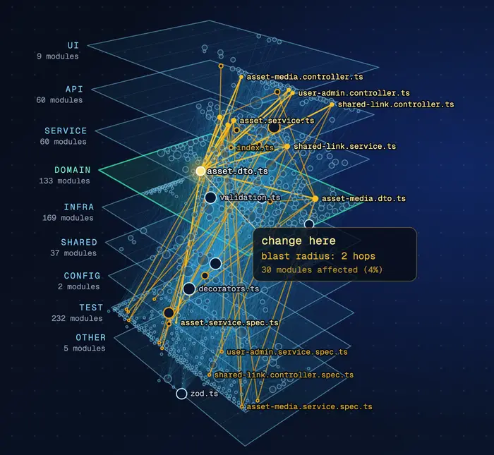
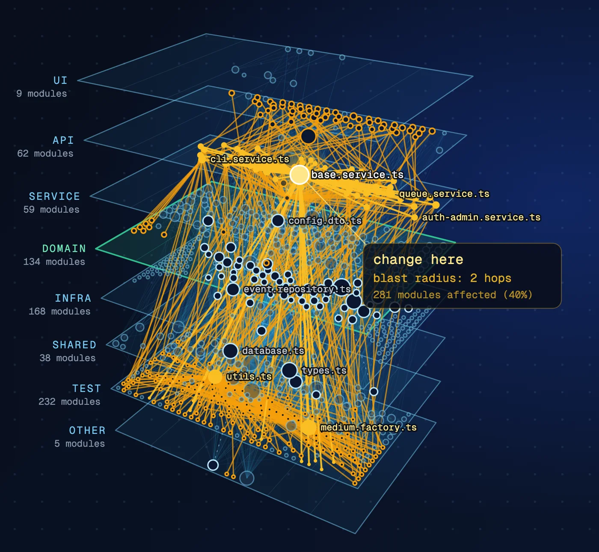

# Wingbox: Code Graph and Blast Radius Analysis for AI Coding Agents


> Wingbox builds a local **code graph** of your repository so that AI coding
> agents and developers can see dependencies, call flows, architecture
> boundaries and the **blast radius** of a change before editing code.
> It works as an agent skill in Claude Code and Codex and supports Python,
> TypeScript, Rust, C#, Java, Go, Ruby, Rails, Free Pascal, and Lazarus.
>
> **Runs fully locally:** no network access, no model, no telemetry. It can be
> used inside a security perimeter and on a machine with no internet.
>
> **Install the agent skill:** `npx skills add aileron-tech/wingbox` | [skills.sh](https://skills.sh)
>
> **Install the command:** `pipx install wingbox` | [PyPI](https://pypi.org/project/wingbox/)
>
> **Release notes:** [Changelog](CHANGELOG.md)
>
> **Note:** Wingbox was formerly published as `codespaces`. The skill, the
> scripts and the generated files were renamed on 2026-11-15; see the
> [Changelog](CHANGELOG.md) for the old and new names.

Understand a large codebase before you change it. Wingbox is an
architecture-aware code search and impact analysis tool for Python, TypeScript, TSX, Rust, C#,
Java, Go, Ruby, Ruby on Rails, Free Pascal, and Lazarus repositories. It helps
developers and AI coding agents find the right module, trace dependencies,
measure change impact, and read only the source files that matter.

Use it for codebase architecture discovery, dependency graph search, blast-radius
analysis, call-flow tracing, monorepo navigation, and safer AI-assisted coding.

Everything runs on your machine. The code graph is built by deterministic
static parsing: no LLM call, no embeddings, no vector database, and no network
access to build or query it.

## Runs fully locally, inside your security perimeter

Wingbox is safe to run on code that must not leave the company:

- **No network.** Building and querying the graph open no network connection.
  Run it with the network switched off to see for yourself:
  `docker run --rm --network none -v "$PWD":/repo wingbox`.
- **No model, no account, no key, no telemetry.** Nothing is sent to a model
  or to a service, and nothing is collected about its use.
- **Your code is read, never run.** Wingbox parses source files with its own
  parsers and calls `git` for the ignore rules; it does not execute the code,
  the tests or the build of the repository. The `--lsp` option, off by
  default, starts a language server that is installed on the machine.
- **The results stay in the repository folder:** `.code_graph.sexp`,
  `wingbox-out/REPORT.md` and `wingbox-out/map.html`. The map is one HTML
  file that loads nothing from outside and opens offline.
- **Works on a machine with no internet.** Fetch the package and its pinned
  dependencies once (`pip download wingbox -d wheels`), carry the folder
  inside, and install with `pip install --no-index --find-links wheels wingbox`.
- **Deterministic and open.** The same code gives the same graph; the source
  is MIT licensed and small enough to review.

Two tests of the repository keep this true: the package imports no module
that opens network connections, and the map page loads no outside resource.

## See it in action

<p align="center">
  
</p>

Once the graph is built, an agent asks what a change breaks before it edits
anything. Real output, Wingbox 0.2.2 on the server of
[immich](https://github.com/immich-app/immich) (commit `e5d6eb7`, 707 modules):

```text
$ wingbox impact src/dtos/asset.dto.ts 2
Impact of changing src/dtos/asset.dto.ts
  direct dependents   10
  within 2 hops       30

Depth 1
  src/controllers/asset-media.controller.ts   imports
  src/controllers/asset.controller.ts         imports
  src/controllers/shared-link.controller.ts   imports
  src/controllers/user-admin.controller.ts    imports
  src/dtos/asset-media.dto.ts                 imports
  src/services/asset-media.service.ts         imports
  src/services/asset.service.ts               imports
  src/services/asset.service.spec.ts          imports
  src/services/shared-link.service.ts         imports
  src/services/user-admin.service.ts          imports

Depth 2
  src/controllers/index.ts                                 imports
  src/controllers/asset-media.controller.spec.ts           imports
  src/controllers/asset.controller.spec.ts                 imports
  ...
```

The answer is 30 files in about 600 tokens, and it is exact: a TypeScript
import resolver written separately from Wingbox finds the same 3,795
dependencies between the 707 modules, none extra and none missing.

`wingbox build` also writes `wingbox-out/map.html`. Its layers view stacks the
architecture in 3D; click a file and its blast radius lights up across the
layers:

| One DTO changes: 30 files within two hops | The base service changes: 281 of 707 modules |
|---|---|
|  |  |

More pictures and a short walk-through: [aileron-tech.fr/wingbox](https://aileron-tech.fr/wingbox).

## What can Wingbox answer?

- Where is authentication, billing, upload, or another feature implemented?
- Which modules depend on this service, class, function, or type?
- What could break if I change this file?
- Which two or three files should I read before fixing a bug?
- How does a request or data value move through the system?
- Does this dependency cross an architecture boundary?
- Which Rails models, services, jobs, mailers, concerns, and specs are affected?
- Can you draw a call-flow, data-flow, or sequence diagram from the code?

Instead of searching a repository one text match at a time, Wingbox turns code
into a queryable code graph of modules, entities, imports, references, call
relationships, architecture layers, and infrastructure connections.

## What is a code graph?

A code graph describes a codebase as facts instead of text. Modules, classes,
functions and types are nodes; imports, references, data flows, calls and
architecture layers are edges. Wingbox writes the graph to `.code_graph.sexp`
as plain S-expression facts, so the bundled query tool and ordinary text search
can both read it.

## What is blast radius analysis?

The blast radius of a change is everything that depends, directly or
transitively, on the code you are about to edit. Wingbox computes it from the
reverse dependencies in the code graph. `impact path/to/file` prints the
dependents by depth and the files to read first; `rdeps` and `boundary` give
the same facts as a tree and as a change boundary.

```text
$ python3 scripts/code_graph_search.py impact scripts/lang/treesitter.py

Impact of changing scripts/lang/treesitter.py
  direct dependents   4
  within 2 hops       11

Depth 1
  scripts/lang/csharp/parser.py   imports
  scripts/lang/go/parser.py       imports
  scripts/lang/java/parser.py     imports
  scripts/lang/ruby/parser.py     imports
...
```

The text form is for people. Agents add `--sexp` to get the same facts as
compact S-expressions.

## Measured: 100 questions, with and without Wingbox

One hundred "which files depend on this file" questions, drawn at random with
a fixed seed in five public repositories (TypeScript, Rust, Python):

- `wingbox impact` names the complete list of dependent files, with nothing
  outside it, in 100 of 100 questions (95 % interval 96 to 100 %). The lists
  hold 1 to 503 files.
- Claude Code answers 55 of the questions with its built-in search only, and
  again with the `wingbox` command added:

| Setup | Complete answers | Tokens per answer | Cost per answer |
|---|---|---|---|
| With Wingbox | 55 of 55 | 32,183 | 0.031 USD |
| Built-in search only | 48 of 55 | 49,292 | 0.063 USD |

  Tokens -35 % (95 % interval -47 % to -20 %), cost -51 % (-58 % to -43 %).
  The saving is large on the Rust and Python repositories and absent on the
  two TypeScript ones.
- Checked against every import statement of seven corpora (3,795 dependencies
  in the largest), the graph has no wrong dependency and one missing: an
  import of a vendored bundle, which Wingbox leaves out of the graph.

The reference lists come from resolvers that share no code with Wingbox. The
scripts, the lists and every result file are in
[benchmarks/impact](benchmarks/impact/README.md), with what the benchmark does
not show. `Dockerfile.benchmark` runs the tests that need no model in a clean
container and compares every result with the committed one:

```bash
docker build -f Dockerfile.benchmark -t wingbox-benchmark .
docker run --rm wingbox-benchmark
```

## Wingbox and Graphify on the same tests

[Graphify](https://github.com/Graphify-Labs/graphify) builds a knowledge graph
of a codebase, documents and images for coding agents. Wingbox is narrower: a
deterministic graph of the code alone, built without a model, and exact lists
of what depends on a file. Both were run on the same public repositories
(Wingbox 0.2.0, Graphify 0.9.110, no model on either side):

| Test | Wingbox | Graphify |
|---|---|---|
| Exact list of dependent files, five questions (`wingbox impact`, `graphify affected`) | 5 of 5 | 1 of 5 |
| Dependencies against the 1,801 import pairs of FastAPI | 0 wrong, 0 missing | 22 wrong, 32 missing |
| Tokens a coding agent spends per answer (built-in search alone: 59,367) | 25,598 | 109,071 |
| Graph of FastAPI on a hosted runner | 2.2 s | 17.9 s |

`graphify affected` follows calls and references as well as imports, so it
answers a wider question than "who imports this file"; the report gives its
figures restricted to imports too. The scripts, the reference lists, every
result file and the token formula Graphify publishes are in
[benchmarks/graphify](benchmarks/graphify/README.md).

## Quick start for AI coding agents

Install the skill:

```bash
npx skills add aileron-tech/wingbox
```

Then ask your agent a natural question:

```text
Use the Wingbox skill before reading source.
Find where file uploads are handled, analyze that module, show its dependencies
and blast radius, then list only the boundary files needed for the change.
```

Wingbox works with Codex, Claude Code, and other clients that support Agent
Skills.

## Quick start from the command line

Install the `wingbox` command (Python 3.11 or newer, macOS or Linux):

```bash
pipx install wingbox
```

Or run it without installing:

```bash
uvx wingbox --help
```

Build the code graph of a project, then ask what a change will break:

```bash
cd /path/to/project
wingbox build .
wingbox impact path/to/file.py
wingbox quick "file upload"
```

`wingbox build [PATH]` accepts the builder options described below, and every
query command in [Common code searches](#common-code-searches) is available as
`wingbox <command>`. The command installs the parsers for all supported
languages and finds `.code_graph.sexp` in the current directory or its parents.

### The report and the map

`wingbox build` writes three things into the project:

| File | For whom | What it is |
|---|---|---|
| `.code_graph.sexp` | AI coding agents | The code graph in a compact form that the query commands read |
| `wingbox-out/REPORT.md` | People | Key findings, the most depended-on files, architecture layers, boundary violations, where to start reading |
| `wingbox-out/map.html` | People | An interactive map of the code graph: one file, opens in a browser, works without a network connection |

On the map, click a file to see its blast radius: the files that depend on it
move onto rings, one ring per hop. The layers view stacks the architecture
layers as planes in 3D and can be turned with the mouse. A link such as
`map.html#select=src/app.ts` opens the map on that file.

Both files are rewritten on every build. Add `wingbox-out/` to `.gitignore`
unless you want them in the repository.

### Run in Docker, with nothing installed

```bash
git clone https://github.com/aileron-tech/wingbox
docker build -t wingbox wingbox

cd /path/to/project
docker run --rm --network none -v "$PWD":/repo wingbox
docker run --rm --network none -v "$PWD":/repo wingbox impact path/to/file.py
```

The first `docker run` builds the code graph, the report and the map of the
mounted project; any other Wingbox command goes after the image name. The
container needs no network, and `--network none` shows it: nothing leaves the
machine. On Linux add `--user "$(id -u):$(id -g)"` so that the written files
belong to you.

### Running the scripts from a clone

Clone the repository:

```bash
git clone https://github.com/aileron-tech/wingbox.git
cd wingbox
```

Build the code graph for an explicit project directory:

```bash
python3 scripts/build_code_graph.py --root /absolute/path/to/project
```

Exclude tracked source snapshots or generated fixture trees by directory name.
The option is repeatable and applies at any depth:

```bash
python3 scripts/build_code_graph.py \
  --root /absolute/path/to/project \
  --exclude-dir review-bundles \
  --exclude-dir generated-fixtures
```

When the target is inside a Git worktree, the builder also honors repository
ignore rules through Git itself. This applies to source files and language
configuration such as `tsconfig.json`, `package.json`, `Cargo.toml`, `go.mod`,
and LSP project discovery. Tracked snapshot paths that still match
`.gitignore` are excluded as well.

Parser packages are loaded only for languages found in that project. Python
needs no extra parser package. If another detected language is not installed,
the builder stops before publishing and prints its exact install command, for
example:

```bash
python3 -m pip install -r requirements/typescript.txt
python3 -m pip install -r requirements/csharp.txt
python3 -m pip install -r requirements/ruby.txt
```

Install only the files for languages you use, then run the same build command
again. `requirements.txt` contains the separate infrastructure-topology
dependency.

Run a relevant search and get the first matching module with its full context:

```bash
python3 scripts/code_graph_search.py \
  --map /absolute/path/to/project/.code_graph.sexp \
  --root /absolute/path/to/project \
  quick "file upload"
```

The code graph is written to `.code_graph.sexp`. Wingbox does not modify the
source files it analyzes.

## Common code searches

| Goal | Command |
|---|---|
| Find and analyze a feature | `quick "payments"` |
| Search for a module | `search "payment.*service"` |
| See full module context | `analyze path/to/module` |
| Find files needed for a change | `boundary path/to/module --files-only` |
| Trace dependencies | `deps path/to/module 2` |
| See what a change will break | `impact path/to/file.py` |
| Measure blast radius as a tree | `rdeps path/to/module 2` |
| Find a class, module, interface, enum, or type | `find_type OrderService` |
| Find a function or method | `find_function createOrder` |
| Find callers | `find_callers createOrder 2` |
| Trace a call path | `find_callchain handleRequest createOrder 5` |
| Search inside function bodies | `grep_functions "validate.*input"` |
| Check architecture boundaries | `boundaries all` |
| Check naming conventions | `invariants all` |
| Inspect changed functions | `diff_functions HEAD~1` |

`analyze` and `impact` always print the complete counts and list at most 200
dependent files, nearest first; add `--all` for every file. `boundaries` reports
an import of TypeScript types only apart from the violations: the compiler
erases it, but a change of the type still reaches the importing file.

Pass the same `--map` and `--root` options shown in the quick start when the map
is outside the current directory.

## Supported languages and projects

| Language | What is indexed |
|---|---|
| Python | Modules, imports, classes, functions, methods, inheritance, and references |
| TypeScript, TSX and JavaScript | Imports, re-exports, classes, interfaces, functions, types, decorators, aliases, and references |
| Rust | Cargo crates, modules, `use` dependencies, structs, traits, enums, functions, implementations, and methods |
| C# | Namespaces, types, interfaces, records, enums, methods, attributes, inheritance, and local type dependencies |
| Java | Packages, imports, classes, interfaces, records, enums, methods, annotations, inheritance, and local type dependencies |
| Go | Modules, packages, imports, structs, interfaces, functions, constants, variables, receiver methods, and local package dependencies |
| Ruby and Rails | Ruby classes, modules, instance and singleton methods, inheritance, requires, Zeitwerk constants, concerns, associations, callbacks, jobs, mailers, and impacted specs |
| Free Pascal and Lazarus | Units, programs, uses/includes, classes, records, interfaces, inheritance, methods, and routines |

Wingbox is designed for single repositories and monorepos. It understands
Python project roots, TypeScript configuration and package aliases, Cargo package
names and local Rust crate dependencies, .NET solutions and projects, Maven and
Gradle projects, Go modules and workspaces, and Rails application/autoload
roots with project acronyms.

Pascal dependencies resolve by case-insensitive unit identity and explicit
`UnitName in 'path.pas'` paths, then by a unique same-directory unit. Other
ambiguous unit names remain unlinked, compiler conditionals are indexed
conservatively, and Pascal does not use LSP enrichment. Automatic Pascal copies
under Lazarus `backup/` directories are excluded without excluding other
supported languages stored under the same path.

It can also map infrastructure relationships from Kustomize, Helm, and Terraform.

## Ruby and Rails dependency search

Rails code often depends on constants without an explicit `require`. Wingbox
builds a project-local constant index and follows conservative Zeitwerk naming
rules, so changing a shared model, concern, service, job, or mailer can reveal
its likely callers and affected specs.

The default Ruby map does not boot Rails. Ambiguous reopened constants remain
unlinked, polymorphic associations stay open, and external or dynamic Ruby
calls are not guessed. This keeps blast-radius results useful without executing
application code.

## A simple workflow

1. Build the map for the exact repository you want to understand.
2. Search for a feature, type, function, or module instead of guessing a path.
3. Analyze the returned module to see dependencies, reverse dependencies, layers,
   references, and the minimal boundary files.
4. Read only those files and make the change.
5. Rebuild the map after structural changes and check boundaries again.

This keeps code exploration focused and gives AI coding agents less irrelevant
context, clearer ownership, and better evidence for implementation decisions.

## Call graphs and diagrams

The default static analysis builds import, reference, data-flow, and architecture
edges. Add `--lsp` when supported language servers are installed to enrich the map
with precise call-site information:

```bash
python3 scripts/build_code_graph.py \
  --root /absolute/path/to/project \
  --lsp
```

You can then ask an agent to render Mermaid diagrams from the graph:

```text
Use Wingbox to trace the file upload flow and render a Mermaid sequence diagram.
Base every participant and edge on the code-graph facts.
```

## Accuracy and limits

Wingbox is an architecture and impact-analysis tool, not a compiler replacement.
The default map comes from deterministic static parsing. Optional LSP enrichment
adds call hierarchy and reference detail when the relevant language server is
available.

For generated imports, runtime dependency injection, reflection, or framework
behavior that is not explicit in source, verify the result against the running
application or the owning framework.

## FAQ

### Does Wingbox send my code anywhere?

No. The code graph is built and queried locally by deterministic static
parsing. Building and querying need no LLM, no embeddings, no vector database
and no network access.

### Which AI coding agents does Wingbox work with?

Codex, Claude Code, and other clients that support Agent Skills. The scripts
can also be run directly from the command line.

### How is a code graph different from text search with grep or ripgrep?

Text search finds lines that match a pattern. A code graph answers structural
questions: which modules depend on this one, what a change can break, which
architecture boundary a dependency crosses, and which few files are worth
reading first.

### How is Wingbox different from Graphify?

Graphify extracts a knowledge graph from code, documents, papers and images,
with a model for the non-code part, and supports more languages. Wingbox reads
code only, with deterministic parsers and no model, and resolves imports the
way each language does, so that `wingbox impact` gives the exact list of files
a change reaches. The two tools are measured side by side in
[benchmarks/graphify](benchmarks/graphify/README.md). Wingbox can be used as a
Graphify alternative when the question is change impact, dependencies and
architecture boundaries of code.

### Does Wingbox replace a compiler or a language server?

No. It is an architecture and impact-analysis tool. Optional LSP enrichment
adds call hierarchy and reference detail; behavior that is not explicit in
source, such as generated imports, runtime dependency injection or reflection,
must be verified against the running application.

### Which languages are supported?

Python, TypeScript, TSX and JavaScript, Rust, C#, Java, Go, Ruby and Ruby on Rails, Free
Pascal and Lazarus, plus infrastructure relationships from Kustomize, Helm and
Terraform.

## Project resources

- [Skill workflow and complete command reference](SKILL.md)
- [S-expression map format](references/sexp-notation.md)
- [Composable query language](references/scheme-queries.md)
- [Changelog](CHANGELOG.md)
- [Completion log](LOG.md)

## License

MIT
